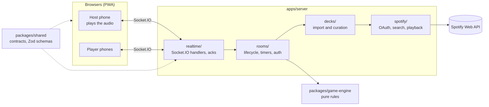

<p align="center">
  
</p>

<h1 align="center">TuneTrack Beats</h1>

<p align="center">
  A real-time multiplayer music party game: listen to a song, guess when it came out, and
  place it on your timeline.<br />
  Mobile-first, plays in the browser, no install.
</p>

<p align="center">
  
  
  
  
</p>

---

## Contents

- [The game](#the-game)
- [Features](#features)
- [Tech stack](#tech-stack)
- [Architecture](#architecture)
- [Getting started](#getting-started)
- [Configuration](#configuration)
- [Testing](#testing)
- [Deployment](#deployment)
- [Documentation](#documentation)
- [Third-party services](#third-party-services)

## The game

TuneTrack is designed to feel better than a physical music card game. One phone hosts the
room and plays the music; everyone else joins from their own browser with a short room code.

**How a round plays**

1. The host creates a room and chooses the music: a saved deck, songs found by search, a
   ready-made quick pick, or the built-in practice deck.
2. Players join with the room code. The host also plays.
3. On each turn a song plays on the host's device. The active player places it on their own
   timeline where they think its release year fits.
4. **Correct:** the card stays. **Wrong:** it is discarded.
5. The first player to collect the target number of cards (default 10, from 3 to 30) wins.

**Tokens and Beat!**

| Action    | Cost     | What it does                                                                                       |
| --------- | -------- | -------------------------------------------------------------------------------------------------- |
| Skip      | 1 token  | Skip the current song (once per turn).                                                             |
| Buy       | 3 tokens | Place the current card automatically.                                                              |
| **Beat!** | 1 token  | Claim that another player placed a song wrongly. Success steals the card; failure costs the token. |

Every player starts with 1 token and holds at most 5; the host awards tokens during the game.
Songs from the same year are interchangeable: any slot inside a same-year block is correct.
When the deck runs out, the cards nobody kept are shuffled back in; if nothing is left, the
player with the most cards wins.

**Release years you can trust.** Spotify often reports the year of a remaster or compilation
rather than the original release. TuneTrack flags such songs, and the host can review and
correct each year before the game; the corrected year is the one players guess.

## Features

- **Instant start:** host a game in one tap, join from an open-room list or a one-word code.
- **Lobby in three steps:** Players, Music and Rules, with one Start button that explains
  what is still missing.
- **Music sheet:** your saved decks, search, and quick picks, without a Spotify login for
  search; playback runs on the host's Spotify Premium device.
- **Song editor:** full-width cover that folds into the bar on scroll, year stepper,
  Year checked switch, and a review flow for flagged songs.
- **Resilient rooms:** offline players keep their seat, the host role transfers after a
  grace period, and every action is idempotent across retries and reconnects.
- **Made for phones:** 48 px touch targets, haptics, thumb-reachable controls, and a separate
  desktop layout that shares the same logic.
- **Motion that explains:** Material 3 timing, scroll-driven folds, celebratory reveals, and
  full `prefers-reduced-motion` support.
- **English and Hungarian**, dark and light themes, a first-game tutorial, and an in-app
  **What's new** page with dated release notes.

## Tech stack

| Layer          | Technology                                                                    |
| -------------- | ----------------------------------------------------------------------------- |
| Frontend       | React 18, TypeScript, Vite, react-router-dom, Framer Motion, CSS Modules, PWA |
| Drag and lists | @dnd-kit, @tanstack/react-virtual                                             |
| Client state   | Zustand (UI preferences and player profile)                                   |
| i18n           | `.properties` catalogues (`en`, `hu`) with a key-parity guard                 |
| Backend        | Node.js, TypeScript, Express, Socket.IO, Pino                                 |
| Validation     | Zod schemas shared between client and server, also for server settings        |
| Storage        | In memory (rooms, Spotify tokens and playback sessions are per room)          |
| Tests          | Vitest, React Testing Library, Playwright with a fake Spotify server          |

## Architecture



**Principles**

- **The server is the single source of truth.** Clients send intents; the server validates,
  applies and broadcasts. Hidden answers (a song's year before the reveal) never reach clients.
- **Game rules live in a pure engine** (`packages/game-engine`) with no framework, timer,
  storage or logging dependencies, so they are tested in depth.
- **Validation at every boundary:** each socket payload is parsed with a shared Zod schema;
  every mutating action is acknowledged and carries a `requestId` the server replays safely.
- **One owner per concern:** transport at the edges (`realtime/`, `http/`), orchestration in
  `rooms/`, timers in one coordinator, state mapping in pure functions.

**Monorepo layout**

```txt
apps/
  web/            React + Vite frontend (PWA): pages, features, services
  server/         Express + Socket.IO backend: app, http, realtime, rooms, decks, spotify
  e2e/            Playwright scenarios against a fake Spotify server
packages/
  shared/         Public contracts, event names, Zod schemas, constants
  game-engine/    Framework-independent gameplay rules
docs/             Rules, the live plan, operations guides
```

## Getting started

**Prerequisites:** Node.js 20 or newer and npm 10 or newer.

```bash
npm install
npm run dev
```

`npm run dev` builds `packages/shared` and `packages/game-engine`, then starts the server and
the web app together.

| Service        | Address                        |
| -------------- | ------------------------------ |
| Web app        | `http://localhost:5173`        |
| Server health  | `http://localhost:3001/health` |
| Design gallery | `http://localhost:5173/dev/ui` |

The practice deck works without any account. Spotify search, playlist import and playback need
a Spotify developer app; see [Configuration](#configuration).

> `packages/shared` and `packages/game-engine` are consumed from `dist/` at runtime. After
> editing either one, rebuild it (`npm run build -w @tunetrack/shared`) before running the
> server or the E2E suite. `npm run dev` and `npm run e2e` do this automatically.

## Configuration

Copy `apps/server/.env.example` to `apps/server/.env` and fill in your own development values.
Every setting is validated at startup (`apps/server/src/app/env.ts`).

| Variable                          | Purpose                                                                | Default                                  |
| --------------------------------- | ---------------------------------------------------------------------- | ---------------------------------------- |
| `SPOTIFY_CLIENT_ID`               | Spotify developer app ID                                               | required                                 |
| `SPOTIFY_CLIENT_SECRET`           | Spotify developer app secret                                           | required                                 |
| `SPOTIFY_REDIRECT_URI`            | OAuth callback URL(s), comma-separated                                 | required                                 |
| `CLIENT_ORIGIN`                   | Allowed web origin(s), comma-separated                                 | `http://localhost:5173`                  |
| `TRUST_PROXY_HOPS`                | Proxies in front of the server (set `1` behind a single reverse proxy) | `0`                                      |
| `MAX_ACTIVE_ROOMS`                | Rooms that may run at once                                             | `5`                                      |
| `RECONNECT_GRACE_MS`              | How long a lobby player may be away before removal                     | `30000`                                  |
| `HOST_TRANSFER_GRACE_MS`          | How long a disconnected host keeps the role                            | `30000`                                  |
| `TURN_SKIP_GRACE_MS`              | Safety auto-skip when the active player is offline                     | `60000`                                  |
| `ALL_PLAYERS_OFFLINE_ROOM_TTL_MS` | Closes a room after everyone has been offline this long                | `3600000`                                |
| `PORT`                            | Server port                                                            | `3001`                                   |
| `LOG_LEVEL`                       | Pino log level                                                         | `debug` in development, otherwise `info` |
| `ENABLE_EVENT_AUDIT`              | Send audit events to the log sink                                      | `false`                                  |
| `AXIOM_TOKEN`, `AXIOM_DATASET`    | Optional log sink; set both or neither                                 | unset                                    |

Test-only overrides (`SPOTIFY_ACCOUNTS_BASE_URL`, `SPOTIFY_API_BASE_URL`,
`TEST_DECK_RANDOM_VALUE`, `TEST_DECKS_DIRECTORY`) are refused outside `NODE_ENV=test`.

## Testing

```bash
npm run typecheck
npm run lint
npm test             # Vitest in every workspace
npm run e2e          # Playwright: chromium, webkit and a mobile WebKit profile
npm run verify       # format, file size, typecheck, lint and coverage in one gate
```

- **Game engine:** placement, Beat! outcomes, turn progression, same-year blocks, deck
  exhaustion and player removal in every phase.
- **Server:** room lifecycle, reconnect and host transfer, authorisation, timers, payload
  schemas, acks and `requestId` replay.
- **Web:** component tests with React Testing Library, plus guard tests for i18n parity,
  design tokens, overlay usage and the motion budget.
- **End to end:** create, join, place, Beat!, reveal, win and recovery, against a fake Spotify
  server with a per-project runtime budget. Tests use fake timers, never real sleeps.

## Deployment

The server is a long-running Node.js process (Socket.IO needs a host without idle spin-down);
the web app is a static build.

- [Railway backend with a static frontend](docs/operations/deploy-railway-frontend.md)
- [Self-hosted](docs/operations/deploy-self-hosted.md)
- [Log sink setup](docs/operations/axiom_logging_setup.md)

Behind a reverse proxy, set `TRUST_PROXY_HOPS` to the number of proxies so rate limits see each
player's own address.

## Documentation

- [docs/README.md](docs/README.md): the index of what is normative, live and archived.
- [CLAUDE.md](CLAUDE.md): the product, game and engineering rules every change follows.
- [Design system](docs/rules/design_system.md): tokens and components.
- [Frontend](docs/rules/frontend_engineering_rules.md) and
  [backend](docs/rules/backend_engineering_rules.md) engineering rules.
- [Decision log](docs/decision_log.md): what was decided, when and why.

## Third-party services

TuneTrack relies on external processors that need a compliance review before any
client-facing deployment:

- **Spotify Web API:** search, playlist import, OAuth and playback on the host's Premium
  account. Search and quick picks use the application's own credentials, without a player
  login.
- **Axiom (optional):** log and audit event sink.

No song metadata is sent to any other service, and no player account is required to play.
